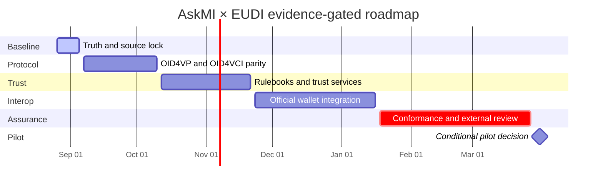

# AskMI × EUDI release-readiness roadmap

> **Repository reconciliation — 2026-10-14:** planning content consolidated from source-watch PR #169
> (`4d4cc604337a88738ec51d9f1ce448d5330e0f56`) onto executable baseline `cacbc95e5ef884e59c688aea41081f8fb7f12fa6`.
> This imports no #141 security code and closes no technical/market gate. #170–#173 and EV-05 must be dispositioned.
> [Current findings](security/REPO_EVIDENCE_STATUS_2026-10-14.md) and [dated evidence](qa/PCC_LEARNINGS_REPO_AUDIT_2026-10-14.md)
> qualify only overlapping paths/claims and preserve existing component evidence. Official-source tags below are the 12 October repository planning registry, not a newly run interop matrix.

**Status:** Active, evidence-gated integrated plan  
**Baseline date:** 2026-10-12  
**Technical/readiness tracker:** [GitHub issue #142](https://github.com/Late-bloomer420/miTch/issues/142)  
**GTM sprint tracker:** [GitHub issue #143](https://github.com/Late-bloomer420/miTch/issues/143)  
**Complete 26-sprint GTM plan:** [GTM_SPRINT_ROADMAP.md](GTM_SPRINT_ROADMAP.md)  
**Baseline candidate:** [Pull request #141](https://github.com/Late-bloomer420/miTch/pull/141)  
**Official-source lock:** [EUDI source baseline](eudi/EUDI_SOURCE_BASELINE.md)

> AskMI is development/evaluation software. This roadmap does not claim EUDI certification, LoA High, production readiness, customers, revenue, or European Commission endorsement. Dates and commercial targets are planning hypotheses; a gate closes only with revision-bound technical evidence or anonymised, auditable market evidence.

## Product decision

AskMI will not fork or replace the European Commission reference wallets. Its commercial category is an **independent EUDI request-governance and evidence layer**: purpose-bound claim minimisation, fail-closed policy decisions, request/schema drift detection, and revision-bound evidence across verifier/connector paths. Transport adapters and verifier integration are enabling components, not the product category.

The first market-validation wedge is DACH travel/hospitality, using one purpose-bound hotel pre-arrival/check-in journey. The preferred scale channel is identity/IAM/system integrators. Age verification remains a demonstration/policy recipe rather than the core market.

The product path is an open Policy SDK, a self-hosted Evidence Gateway, and a paid four-to-six-week Readiness Sprint. Discovery and paid readiness/design work may proceed before pilot readiness; a live credential pilot may not bypass the technical, security, privacy, legal, and operating gates below.

The repository's browser wallet remains a test/reference harness, not a certified EUDI Wallet Solution.

The public EC implementation is a multi-repository organization, not one monolithic "original wallet" repo. The primary mobile anchors are the official [Android wallet](https://github.com/eu-digital-identity-wallet/eudi-app-android-wallet-ui) and [iOS wallet](https://github.com/eu-digital-identity-wallet/eudi-app-ios-wallet-ui), backed by their official core libraries.

## Authority and evidence

### Observable trust outcomes — additive planning, 2026-10-14

The [assurance and role contract](security/TRUST_ASSURANCES_AND_ROLE_BOUNDARIES.md) defines TR-1 understandable promises (#175), TR-2 one bounded real transaction (#170/#171), TR-3 authenticated agent authority (#177), TR-4 role/provider dependencies and exit (#176/#97), and TR-5 operating evidence (#172/#173 and existing independent/release gates). These milestones refine the existing waves; they are not completed controls, new calendar commitments or replacements for G0/G1. #178 owns this documentation intake. The first code slice remains #170 plus relevant #141 baseline reconciliation.

| Surface | Authority |
|---|---|
| [EUDI source baseline](eudi/EUDI_SOURCE_BASELINE.md) | Official source/version lock and AskMI role boundary |
| This roadmap | Technical sequencing, hard pilot gates, dependencies, and planning windows |
| [GTM sprint roadmap](GTM_SPRINT_ROADMAP.md) | Complete 26-sprint market-validation, offer, pilot-learning, conversion, and stop-gate plan |
| [Issue #142](https://github.com/Late-bloomer420/miTch/issues/142) | Live technical/readiness checklist and current evidence links |
| [Issue #143](https://github.com/Late-bloomer420/miTch/issues/143) | Live GTM sprint/gate tracker and anonymised market evidence |
| [BACKLOG.md](BACKLOG.md) | Individual task state and priority |
| [STATE.md](../STATE.md) | Current operational snapshot |
| [RC checklist](RELEASE_CANDIDATE_CHECKLIST.md) | Clean-checkout release evidence |
| [Maturity and limitations](MATURITY_AND_LIMITATIONS.md) | Permitted product/evidence language |
| [docs/qa](qa/) | Dated, revision-bound validation records |

Internal tests establish implementation behavior only. They do not establish legal compliance, certification, external interoperability, or LoA High.

## Current implementation truth

| Area | Repository truth | Classification | Consequence |
|---|---|---|---|
| Policy mediation | Fail-closed policy engine, claim enforcement, audit/data-flow surfaces, negative tests | Implemented internally | Exercise through official-wallet interop |
| SD-JWT VC | Issuance, disclosure, key-binding, verification primitives | Internal; rulebook conformance unproven | Map exact PID/EAA rulebooks and official payloads |
| mdoc | CBOR/COSE, MSO, issuer/device auth, offline verification | Internal; official interop unproven | Add PID/mDL vectors, transport, reader-auth, status |
| OpenID4VP | Presentation Exchange / presentation_definition | Partial; current EC profile uses DCQL | Implement OpenID4VP 1.0 + DCQL; legacy must be explicit |
| OpenID4VCI | Custom/draft subset with offer, proof, issuance, batch | Partial; 1.0 not demonstrated | Align metadata, grants, nonce, deferred/notification, encryption, errors |
| HAIP/attestation | Custom verifier/client attestation helpers | Partial; current-profile equivalence unproven | Reconcile against current HAIP and official tests |
| Trust | JSON DID-list PoC and configurable anchor path | PoC; not ETSI LoTE/Trusted Lists | Add ETSI TS 119 602/119 612 and RP certificate validation |
| Status/revocation | Status-list prototypes and checks | Partial; profile coverage unproven | Validate signer, freshness, failure, privacy semantics |
| Identity/key seam | WebAuthn-backed path and identity guardian | Useful seam; not WSCA/WSCD certification | Keep browser claims narrow; rely on native wallet security |
| Issuer connection | eID connector simulated; national eID modes are stubs | Demo only | Exclude real PID issuance until a provider exists |
| Browser wallet | Complete demo journey and recovery controls | Reference harness | Use for CI/diagnostics, never certification claims |
| External evidence | No official-wallet interop, FCAF result, protocol result, or independent security review | Missing | Blocks pilot go/no-go |

## Claims correction

The June 2026 CIR matrix is a historical internal engineering checklist. Its "98%" total, LoA High row, hardware-binding row, and FCAF-readiness row are not conformance or certification evidence. Replace it with requirement-level traceability against the locked official baseline. Until then, no percentage may appear in release or marketing claims.

## Delivery timeline

Production is intentionally unscheduled.

**Schedule variance — 2026-10-12:** Wave 0 and G0 remain open while the source-baseline stack through PR #168 is unlanded. The G1 buyer gate due 11 October also elapsed without a published completed-interview tally or evidence for 20 interviews, at least 8 problem confirmations and at least 3 buyer/procurement/deadline signals. G1 remains open and the stated stop rule applies: pause broad product expansion until the buyer/workflow/category hypothesis is evidenced or revised. No technical or commercial gate closes from elapsed time.

## Integrated market-validation track

The technical Waves 0–4 remain hard readiness gates. They now run beside the complete [26-sprint GTM and pilot-validation plan](GTM_SPRINT_ROADMAP.md), tracked live in [issue #143](https://github.com/Late-bloomer420/miTch/issues/143).

| Commercial gate | Target | Required evidence |
|---|---:|---|
| G0 — truth | 13 Sep 2026 | #141 merged/re-baselined; truthful claims and product boundary |
| G1 — buyer | 11 Oct 2026 | 20 interviews; at least 8 problem confirmations; 3 budget/procurement/deadline signals |
| G2 — offer | 22 Nov 2026 | two design partners and at least one paid Readiness Sprint |
| G3 — interop/package | 17 Jan 2027 | frozen Android/iOS matrix, two adapter paths, measured unassisted quickstart |
| G4 — conditional pilot | 31 Mar 2027 | Waves 0–4, no P0/P1/high unresolved finding, legal/privacy scope and runbooks |
| G5 — conversion | 20 Jun 2027 | at least three paying organisations, one annual conversion, repeated buyer/problem |
| G6 — year one | 29 Aug 2027 | honest review against 5–8 customers, two channels, and €200k–€400k exit-ARR planning target |

A missed buyer or offer gate stops broad product expansion. A missed pilot gate moves the pilot date and cannot be waived commercially. Commercial counts and revenue are planning targets, not forecasts or current-state claims.

Customer discovery, synthetic-data demonstrations, and paid readiness/design engagements may run before G4. No live credential pilot starts before the 31 March go/no-go and its linked evidence. Public GitHub evidence must remain anonymised and must not contain prospect/customer names, contact data, confidential notes, contracts, or raw customer data.

## Wave 0 — truth, source lock, and repository convergence

**Target:** 26 August–4 September 2026

- Reconcile #141 security changes against current master and rerun final-head checks. Its original three inline threads are resolved; the PR still has baseline conflicts. Documentation publication alone is not the security merge.
- Close/re-scope stale PRs using the disposition table below.
- Lock [ARF v3.0.0](https://github.com/eu-digital-identity-wallet/eudi-doc-architecture-and-reference-framework/releases/tag/v3.0.0) and exact official component tags.
- Replace the CIR percentage with traceability fields: requirement, source/version, AskMI role, implementation, test, external evidence, status, owner, review date.
- Freeze the pilot profile: AskMI verifier/middleware + official Android first; iOS parity before pilot.
- Pin Node/pnpm consistently and remove or quarantine stale npm lockfiles.

**Exit:** one canonical revision; no stale PR presented as merge-ready; dated source lock; consistent middleware/reference-harness wording; unsupported percentages marked historical.

## Wave 1 — current protocol parity

**Target:** 7 September–9 October 2026

### OpenID4VP 1.0 and DCQL

- Add DCQL parsing, validation, authorization, and minimal-disclosure mapping.
- Support official same-device/cross-device request and response profiles, request objects, nonce/state/session binding, and current response modes.
- Reject ambiguous negotiation and unsupported requests; preserve Presentation Exchange only behind an explicit legacy profile.
- Add replay, expiry, mix-up, redirect, downgrade, malformed-request, and over-disclosure tests.

### OpenID4VCI 1.0

- Align issuer/auth-server metadata, credential configurations/offers, authorization-code and pre-authorized-code grants, PKCE/PAR where applicable, nonce, proof, token, credential, batch, deferred, notification, encrypted response, and errors.
- Remove custom field names and draft assumptions at public boundaries.
- Add key binding, replay handling, and privacy-aware batch behavior.
- Run against the locked official issuer and official wallet-core examples.
- Test both attested-client and public-client modes introduced in iOS Wallet Kit v0.40.9; if authorization-server metadata omits client-attestation algorithms, require an explicit configured client ID and record the selected mode.
- Treat client mode and credential-proof mode as separate policy dimensions. Default to attested proofs; allow v0.52+ plain JWT proof only for an explicit issuer/profile policy, constrain algorithms to the supported ES256/ES384/ES512 set, record the decision, and test downgrade rejection.
- Bind JWT and key-attestation proof `iss` to the resolved client ID from the active issuer configuration, not to the credential-issuer identifier. Include a regression where those identifiers differ for attested and explicitly allowed plain-proof modes.
- Require signed SD-JWT credentials with an explicit positive algorithm allowlist; add missing-signature, `alg: none`, unsupported-algorithm and invalid-signature negatives.
- When authorization-server metadata advertises RFC 9207 support, require and validate the authorization-response `iss` against the expected issuer; cover missing, mismatched and mix-up responses, and preserve discovery/metadata/offer/authorization/token error classes.
- Issue unique, immutable, short-lived/single-use credential-offer URIs; test repeated cached resolution, expiry, and replay, and never depend on mutating offer content behind an unchanged URI.
- Support and test multiple credential identifiers in one offer/response, preserving per-credential configuration, proof, result and error state.
- Make issuance-proof profile selection explicit across Android/iOS evidence: ETSI/attested remains the deny-biased default; any Standard/plain or no-proof mode requires a named profile decision and downgrade-negative coverage.

### CI and exit evidence

- Add failure-gating browser E2E and container build/start smoke tests.
- Commit the ADOPT/live probe as a rerunnable gate.
- Publish a clean-checkout RC report for one exact SHA.
- Publish a profile matrix: supported, legacy, rejected, unimplemented.
- Record official issuer ↔ AskMI wallet/harness and AskMI issuer ↔ official wallet flows; no protocol claim rests only on unit tests.

## Wave 2 — credential rulebooks, trust, and registration

**Target:** 12 October–20 November 2026

### Credential profiles

- Implement exact current PID schemas for SD-JWT VC and mdoc and the mDL profile required by the pilot.
- Resolve issue #97 using rulebook-defined age semantics, not a repo-local claim shape.
- Validate namespaces, types, mandatory/optional attributes, metadata, validity, key binding, and disclosure.
- Align PID schemas and fixtures to tagged PID issuer v0.11.1: remove separate house-number and `trust_anchor` claims, add administrative-validity dates, allow derived/optional expiry, and distinguish administrative validity from credential issuance/expiry.
- Define a fail-closed SD-JWT certificate-header policy for `x5c`, `x5u`, and `x5t#S256`; any remote certificate retrieval must be allowlisted and bounded, and the thumbprint and trusted chain must match.
- Define status/revocation per format and record dependencies on evolving ISO work.
- For JWT status tokens, require an explicit asymmetric algorithm allowlist and trusted signer chain; reject missing algorithm, `none`, HS/MAC, invalid and unsupported values before accepting certificate-trust warnings or status content.
- Defer AV/ZKP and additional attestations unless the frozen pilot requires them.

### Trust and relying-party services

- Replace the JSON DID-list PoC on the pilot path with ETSI TS 119 602 LoTE and/or ETSI TS 119 612 Trusted List processing required by the selected EC profile.
- Validate list signatures, anchors, service status, validity, rollover, revocation, cache expiry, network failure, and rollback.
- Make certificate revocation an explicit production-profile setting and prove fail-closed CRL/OCSP behavior, bounded cache lifetime, cleanup, outage handling and rollback. Use Trust Validator v0.3.0-alpha only as a reference until a stable gate anchor is selected.
- Validate relying-party access and registration certificates, registered scope, and intended use.
- Exercise RP registration v0.2.2 contracts: object-shaped credential/provided-attestation metadata, certificate-history selection, intermediary identifiers, and status-list references.
- For the Launchpad 2026 legal-person/no-intermediary profile, pin TS5 v1.3, TS6 v1.1, ETSI TS 119 411-8 v1.1.1 and ETSI TS 119 475 v1.2.1; prove WRPAC issuance precedes WRPRC, and keep the password-protected PKCS#12 private key out of source, logs and artifacts. Test intermediary flows separately.
- Preserve registered WRP, access-certificate subject, presenter/intermediary, intended-use identifier, certificate revision/status, and validation source as distinct audit fields.
- Define a dedicated OID4VP presentation-audit record and identifier: create it as non-completed before credential selection, update that presentation record idempotently, complete only after successful response delivery, and keep cancellation, rejection, failure and interruption non-completed with `reasonOfNoncompletion`. Store requested/presented paths and nested WRPRC `srv_description` without claim values.
- Define a separate OID4VCI issuance-audit record and identifier that remains stable across token-refresh/retry attempts and records per-credential, background-update and unsuccessful issuance outcomes. Never reuse an issuance identifier or record type for a presentation lifecycle.
- Bind policy to trusted issuer, RP identity, registration scope, rulebook, and requested attributes.
- Create trust onboarding, suspension, revocation, incident, and outage runbooks.

**Exit:** requirement traceability for frozen PID/mDL profiles; negative tests for untrusted issuer/RP, excess scope, stale/revoked trust, and outages; dated trust ceremony/rollover/revocation evidence.

## Wave 3 — official EC wallet integration and pilot hardening

**Target:** 23 November 2026–15 January 2027

Integration order: official Android wallet/core, official iOS wallet/core, official EC issuer/verifier comparison anchors, then AskMI as verifier middleware/adapter—not a replacement wallet.

Current released mobile anchors are Android and iOS 2026.10.43-Demo build 43. The independent core anchors are Android v0.31.0 and iOS v0.54.8; iOS build 43 integrates Wallet Kit v0.52.1 and must not be represented as a v0.54.8 UI/core combination. Build-42 and older results remain historical and do not satisfy the current matrix.

- Record exact tags/SHAs, profile, credential, device/OS, configuration, result, deviations, logs, and artifacts for every run.
- For iOS Wallet Kit v0.40.9+ evidence, record the OpenID4VCI client mode and the credential-offer URI/cache, expiry, and replay results.
- Treat the iOS wallet UI build and wallet-core tag as separate coordinates; do not claim an untested UI/core combination.
- For iOS Wallet Kit v0.54.8, use iOS 17+, delete and reissue pre-v0.50 stored credentials, record the SwiftData/keychain backend and app-group configuration, prove registration reconciliation immediately after issuance/storage changes, record authentication prompt count/context lifetime, and capture the ETSI revocation setting with fail-closed status negatives.
- Record client mode, credential-proof mode, proof `iss`/resolved client ID, device-signature algorithm and separate issuance/presentation transaction-log state transitions for v0.54.8; cover stable issuance retry IDs, background updates, nested `srv_description`, rejection with and without redirect, cancellation, interruption, failed delivery and successful delivery. Do not carry build-43 UI evidence forward as v0.54.8 evidence.
- Gate every X.509 OpenID4VP response on successful reader authentication bound to the active request identity. Test missing trust evaluation, untrusted/invalid certificate and signature, malformed or incomplete decoding, stale state after failure, overlapping receives and response attempts after unauthenticated requests; reset authentication, consent and selected-data state between requests.
- Treat Android main's issuer-specific authorization resumption and revoked-document UI refresh as watch regressions until they are in a tagged UI build; do not relabel main-branch evidence as build 43.
- For Android build 43/core v0.31.0, record biometric authenticator strength and cover strong-capable success, weak-only rejection, cancellation, terminal errors and duplicate-prompt prevention; rerun reader-auth, missing-chain, invalid-signature, rejected-presentation, multiple-credential and explicit proof-profile negatives.
- Treat TrustMark as display metadata only; its presence must never satisfy certification, trust or gate evidence.
- Keep verifier UI v0.13.0 and verifier endpoint v0.12.0 as separate coordinates. Test the endpoint status-check configuration rename, wallet-`iss`/JAR-`aud` binding, authorization-request `iat`, validation outcomes and typed response-return failures.
- Complete handoff state, request TTL, popup/same-tab fallback, session binding, recovery, and return-to-verifier UX.
- Deliver verifier adapter/button and server middleware with deny-biased defaults.
- Establish hosted staging with explicit origins, keys, trust sources, retention, health checks, and artifact traceability.
- Run same-device, cross-device, expiry, retry, denial, partial-consent, revocation, trust-failure, and recovery paths.
- Include proximity only if transport, reader auth, status limits, and official-device evidence are ready.
- Keep Digital Credentials API deferred for the frozen pilot unless scope is explicitly reopened. Verifier UI v0.13.0 now tags the ITB/DC API flow, but the release does not change the frozen scope.

**Exit:** Android and iOS official-wallet matrices pass; a new RP integrates without source changes or insecure defaults; browser wallet remains labelled as a harness.

## Wave 4 — conformance, assurance, and operations

**Target:** 18 January–26 March 2027

### Functional conformance

- Create an Implementation Conformance Statement for the exact AskMI role/profile.
- Run applicable tests from locked [FCAF v0.0.10](https://github.com/eu-digital-identity-wallet/eudi-doc-functional-conformance-assessment/releases/tag/v0.0.10) and archive results.
- Run applicable OpenID Foundation protocol conformance tests.
- Reuse/adapt the official [EUDI testing application](https://github.com/eu-digital-identity-wallet/eudi-doc-testing-application) for UI/device evidence.
- Record exclusions/failures; never convert non-applicable tests into coverage.
- State that FCAF is functional evidence, not security/privacy certification.

### Security, privacy, and operations

- Complete independent security/cryptographic review and disposition findings.
- Deploy production-grade key management, rotation, recovery, and separation.
- Implement session storage for the target topology.
- Review correlation/linkability, batch, RP impersonation, injection, replay, downgrade, recovery, and trust compromise.
- Exercise monitoring, incident/vulnerability response, backup/restore, rollback, privacy/deletion/reporting, and support runbooks.
- Complete legal/privacy review for actual pilot actors, data, jurisdiction, retention, processors, and user communications.

**Exit:** no unresolved critical/high finding; revision-bound FCAF/ICS/protocol results; exercised runbooks; signed pilot scope, owners, metrics, stop conditions, and exit criteria.

## Conditional limited-pilot gate

**Target decision:** 31 March 2027

A go decision requires Waves 0–4 with linked evidence; official Android/iOS interop; no P0/P1 or high unresolved finding; deployment traceability; exercised trust/key/session/ops/privacy/support controls; named owners; and a written decision that does not claim production readiness or Wallet Solution certification. Material official-profile changes move the date and invalidate affected evidence.

## Deferred/out of pilot scope

- competing as a proprietary wallet, generic all-wallet connector, or standalone age-verification vendor;
- managed processing or retention of raw credentials before demand, architecture, privacy, and legal review justify it;
- becoming a certified EUDI Wallet Solution or claiming LoA High/WSCA/WSCD compliance;
- qualified electronic signatures, Digital Credentials API, wallet-to-wallet, backup/migration/multi-device continuity;
- ZKP/BBS+ and advanced anonymous credentials;
- national PID issuance through simulated eID connectors; and
- production launch.

## PR and issue disposition

| Item | Required action |
|---|---|
| PR #141 | Merge as truth/source-roadmap baseline after final review/checks |
| PR #140 | Separate PostCSS from the Vite 8/toolchain migration |
| PR #138 | Already merged 2026-10-01; preserve its accepted ADOPT/research alignment |
| PR #130 | Already merged; preserve existing pool work and track real-SD-JWT parity under #171 |
| PR #139 | Closed historical mixed-scope input; no completion inferred from closure |
| PR #129 | Re-scope UX after protocol/profile decisions |
| PR #105 | Close stale tunnel work; separately justify endpoint fallback |
| Issue #97 | Keep open until official age semantics are evidenced |
| Issue #122 | Scoped fix #125 is present; close with the current two negatives/63-test focused evidence |
| Issue #95 | Superseded by AskMI naming and accepted #158 product boundary |

## Production gate — intentionally undated

Production becomes schedulable only after successful pilot exit plus durable governance, external assurance, interoperability, legal/privacy review, operational controls, and support. If AskMI becomes a Wallet Solution, it needs a separate certification programme; this roadmap neither grants nor predicts certification.

## Update discipline

- Update issue #142 when a gate changes; link evidence.
- Update the source baseline when an official dependency/profile changes.
- Update BACKLOG.md for task state and STATE.md for operational facts.
- Store dated verification in docs/qa with exact revisions/environment.
- Never close a gate from a plan, stale branch, internal percentage, or historical run.

## Active remediation linked to the waves — 2026-10-14

| Work | Gate | Implementation/evidence status |
|---|---|---|
| #170 ADOPT request/session/eligibility | Wave 1 / ADOPT-1.2-code | Open; existing helpers do not close the active HTTP path |
| #171 real SD-JWT single-use | Waves 1/4 | Open; preserve delivered legacy B+C mechanism |
| #172 audit/telemetry sinks | Wave 4 | Open; schema exists, runtime integration/retention not established |
| #173 source-bound evidence/file bytes | Waves 0/1/4, SEC-AUDIT-3 | Open; 10 manifest PASS do not cover these counterexamples |
| EV-05 CI audit threshold | Wave 0, #141 / SEC-AUDIT-1/2 | Open; critical synthetic JSON exits 0 on master |
| GAP-1/GAP-4 and F-19/F-20 | Wave 4/residuals | Explicitly open; no downgrade hidden by a success label |

Do not move G0/G1 or promote future sprints from this documentation-only reconciliation.
Numerical `age` is the current accepted Connect profile; a no-raw-age claim needs an explicit profile decision under #97.

### Goal preservation — 2026-10-15

Fingerprinting prevention, control of every disclosure and complete user-inspectable transaction history remain product goals. Current limitations describe unfinished work, not a goal change. Track **goal → scoped evidence → remaining acceptance criteria** in [the trust contract](security/TRUST_ASSURANCES_AND_ROLE_BOUNDARIES.md). #175 owns the assurance/correlation mapping; #172/#175 own full transaction-history coverage and actual outcomes; #170 owns active-route disclosure enforcement. Existing component results and dated records remain intact. No goal is retired and no implementation gate is closed by this clarification.
