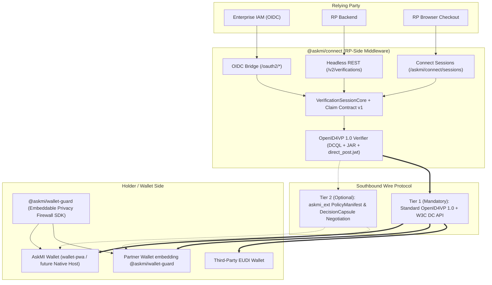

# AskMI API & Protocol v2 Architecture Plan — 2026-11-03

**Date:** 2026-11-03  
**Baseline:** `chore/enable-entire` (`f15cf8d`)  
**Input Evidence:** [`docs/qa/API_PROTOCOL_REALITY_AUDIT_2026-11-03.md`](../qa/API_PROTOCOL_REALITY_AUDIT_2026-11-03.md)  
**Status:** Accepted architectural direction and 4-stage execution plan (documentation & planning gate; executable code changes follow in Stages 0–3).

---

## 1. Strategic & Architectural Decisions

The following six architectural invariants govern the evolution of AskMI's APIs and packages:

1. **Open Commercial Deployment Role (Pending G0/G1 Discovery Gate `#143`):**
   - Customer and legal role validation (Relying-Party-deployed middleware vs. Registered Intermediary vs. Wallet Provider / SDK vendor) remains open pending G0/G1 discovery evidence.
   - Package boundaries must preserve all three deployment options without conflating their regulatory responsibilities under CIR (EU) 2024/2982, ETSI TS 119 475 (WRPAC/WRPRC), and CIR (EU) 2024/2981 (LoA High).
2. **Dual Wallet Strategy (`@askmi/wallet-guard` SDK + Long-Term `AskMI-Wallet` Product):**
   - **Extract `@askmi/wallet-guard`:** The portable holder-side privacy firewall (request normalization, `PolicyEngine` evaluation, claim clipping to `authorized_requirements`, single-use pool consumption `#171`, `DecisionCapsule` signing, and local tamper-evident audit logging) will be extracted from `wallet-pwa/src/services/WalletService.ts` into a standalone, embeddable `@askmi/wallet-guard` package.
   - **Retain & Evolve `wallet-pwa` (`AskMI-Wallet`):** `wallet-pwa` becomes a thin UI/platform shell over `@askmi/wallet-guard` and remains the foundation for a standalone AskMI Wallet product (with a long-term path toward native hardware-keystore integration and certification).
3. **Unified 3-Surface Northbound RP API (`@askmi/connect`):**
   - A single framework-agnostic `VerificationSessionCore` will power three northbound Relying Party integration surfaces:
     1. **Connect Session API (`/askmi/connect/sessions`):** Evolved browser session & widget API.
     2. **Headless REST API (`POST /v2/verifications`, `GET /v2/verifications/:id`, webhooks):** Stripe-style backend verification API returning minimized predicate verdicts (`{ status, claims: { age_over_18: true }, receipt }`).
     3. **OIDC-Provider-Bridge (`/.well-known/openid-configuration`, `/oauth2/authorize`, `/oauth2/token`):** Zero-code drop-in for enterprise IAMs (Keycloak, Auth0, NextAuth, Cognito) issuing pseudonymous, data-minimized ID tokens (`{ sub, age_over_18: true, acr }`).
4. **Two-Tier Southbound Wire Protocol (100% Standard Baseline + Optional `askmi_ext` Negotiation):**
   - **Mandatory Interop Baseline:** Every OpenID4VP request and response MUST be 100% compliant with standard **OpenID4VP 1.0 Final** and **W3C Digital Credentials API** (`navigator.credentials.get({ digital })`), ensuring:
     - `@askmi/connect` verifiers interoperate out-of-the-box with any third-party EUDI Wallet.
     - `@askmi/wallet-guard` and `AskMI-Wallet` interoperate out-of-the-box with any third-party EUDI Verifier.
   - **Optional AskMI-to-AskMI Extension (`askmi_ext`):** When both Verifier and Wallet run AskMI components, they optionally negotiate AskMI privacy extensions (`client_metadata.askmi_ext` in the JAR request; `askmi_capsule` in the response) to exchange verifier policy manifest hashes, privacy-budget attestations, and hardware-/passkey-signed `DecisionCapsule` receipts without breaking standard wallets or verifiers.
5. **Southbound Credential Profile Sequencing:**
   - First wire the existing canonical contract in [`src/packages/shared-types/src/contracts/claim-contract.ts`](../../src/packages/shared-types/src/contracts/claim-contract.ts) (`age_over_18`, `birthdate`) in Stage 0; select the primary production profile (`dc+sd-jwt` `urn:eudi:pid:1` vs. `mso_mdoc` `eu.europa.ec.av.1`, Issue `#97`) in Stage 1 based on G0/G1 evidence.
6. **Documentation-First Governance:**
   - Record all reproduced defects (`API-01`..`API-07`) and stage gates transparently in repository trackers before modifying executable code in `src/`.

---

## 2. Two-Tier Wire Protocol & Multi-Surface Architecture

### Graceful `askmi_ext` Negotiation Rules
- **Verifier → Wallet (Request Object):**
  - Standard fields (`response_type: "vp_token"`, `client_id` with prefix, `response_mode: "direct_post.jwt"`, `response_uri`, `nonce`, `state`, `dcql_query`, `verifier_info`) strictly follow OpenID4VP 1.0 Final.
  - Optional extension field `client_metadata.askmi_ext` carries `{ version: "1.0", policy_manifest_hash, requested_attestations: ["decision_capsule_v1"] }`.
  - Standard third-party EUDI wallets ignore unknown `client_metadata` keys per RFC 7519 / OpenID4VP 1.0 and return a standard `{ vp_token, state }` response.
- **Wallet → Verifier (Response):**
  - If `@askmi/wallet-guard` detects a standard third-party verifier (no `askmi_ext`), it emits a pure standard OpenID4VP response (`{ vp_token, state }`) and stores the `DecisionCapsule` locally in the holder's audit log.
  - If `@askmi/wallet-guard` detects a valid `askmi_ext` from an AskMI verifier, it additionally attaches `askmi_capsule` (PII-free cryptographic proof of local policy evaluation and holder presence) to the encrypted `direct_post.jwt` payload.

---

## 3. Four-Stage Execution Roadmap

### Stage 0 — Security, Spec-Compliance & E2E Hardening (`API-V2-S0`)
**Goal:** Fix all reproduced security, cryptographic, and live E2E integration defects (`API-01`..`API-05`) on the existing stack before adding new protocol surfaces.

| Task ID | Scope | Target Files | Acceptance Criteria |
|---|---|---|---|
| **API-01** | Fix 4-way live browser E2E break & wire `claim-contract.ts` | `src/packages/connect/src/core/profile.ts`, `src/packages/connect/src/browser/handoff.ts`, `src/apps/wallet-pwa/src/App.tsx`, `src/apps/wallet-pwa/src/data/DemoPolicy.ts`, `src/apps/issuer-mock/src/index.ts`, `src/apps/verifier-demo/backend/src/app.ts`, `dev-demo.ps1` | 1. Connect profile uses canonical `claim-contract.ts` (`age_over_18` / `birthdate`) instead of raw `$.age`. 2. Handoff URL routes directly into `<WalletApp>` when `request_uri` is present. 3. HTTPS/HTTP & CORS origins match across `wallet-pwa`, `verifier-demo`, and `dev-demo.ps1`. 4. `issuer-mock` and `verifier-demo` share a consistent default `iss`. 5. Unmocked E2E test runs real `PolicyEngine.evaluate()` with `DemoPolicy` (no `bootstrapFetchMocks('ALLOW')` override). |
| **API-02** | Close `presentOID4VP` policy-clipping bypass | `src/apps/wallet-pwa/src/App.tsx:959-961` | `presentOID4VP` discloses only claims present in `result.decisionCapsule.authorized_requirements`; negative test proves over-asked claims in `authRequest.presentation_definition` are excluded from the SD-JWT presentation. |
| **API-03** | Enforce RFC 9901 §7.1 & mandatory KB-JWT verification | `src/packages/shared-crypto/src/sd-jwt-vc.ts`, `src/packages/oid4vp-verifier/src/response-verifier.ts` | 1. `validateSDJWTVC` enforces `typ` (`dc+sd-jwt` / `vc+sd-jwt`) and allowed `algorithms`. 2. `extractDisclosedClaims` rejects the presentation on any malformed or unmatched disclosure (no `continue`). 3. `buildSdJwtPresentation` emits `<issuerJwt>~<kbJwt>` (single `~`) when 0 disclosures are selected. 4. `response-verifier.ts` defaults `verifyCredentialSignatures` to `true` and rejects missing KB-JWT (`<issuerJwt>~<disc>~`) when holder binding / `expectedNonce` applies. |
| **API-04** | Fix ISO/IEC 18013-5 §9.1.3.6 `DeviceAuthenticationBytes` | `src/packages/mdoc/src/device-auth.ts` | `signDeviceAuth` and `verifyDeviceAuth` sign/verify detached payload (`payload: null`) over `Tag24(CBOR(["DeviceAuthentication", SessionTranscript, docType, DeviceNameSpacesBytes]))` with empty `external_aad`; test vectors cover `OpenID4VPHandover` and `OpenID4VPDCAPIHandover`. |
| **API-05** | Fail-closed Trust List, Status List & WebAuthn Verifier | `src/packages/shared-crypto/src/trust-list-resolver.ts`, `src/packages/revocation-statuslist/src/index.ts`, `src/packages/webauthn-verifier/src/index.ts` | 1. `trust-list-resolver` never returns `verified: true` when `anchorPublicKey === null` and enforces immediate fail-closed on expired cache for `riskTier === 'high'`. 2. `revocation-statuslist` verifies the status list issuer signature and supports IETF `statuslist+jwt`. 3. `webauthn-verifier` cryptographically verifies `signedAssertion.response.signature` against `publicKeyCose`. |

---

### Stage 1 — G0/G1 Discovery Evidence & Southbound Profile Selection (`API-V2-S1`)
**Goal:** Align technical buildout with validated customer demand (`#143`) and select the primary southbound credential profile (`#97`).

- Complete G0/G1 discovery interviews (`#143`) and document the primary commercial deployment model (RP-deployed middleware vs. wallet SDK licensing vs. intermediary).
- Select the primary southbound credential format for the beachhead pilot:
  - **Option A (`dc+sd-jwt`):** `urn:eudi:pid:1` with `age_equal_or_over.18` (`nested-threshold` binding in `claim-contract.ts`).
  - **Option B (`mso_mdoc`):** EU Age Verification Profile `eu.europa.ec.av.1` (`age_over_18` boolean element, Issue `#97`).

---

### Stage 2 — `@askmi/wallet-guard` Extraction & 3-Surface RP Northbound API (`API-V2-S2`)
**Goal:** Decouple portable wallet protection logic from the PWA shell and expose all three RP integration surfaces on a shared core.

- **`@askmi/wallet-guard` Package:**
  - Extract framework-agnostic holder firewall (`evaluateIncomingRequest`, `clipDisclosuresToCapsule`, `consumeSingleUseCredential` for `#171`, `buildAskMICapsule`, `recordDisclosureAudit`) from `wallet-pwa/src/services/WalletService.ts`.
  - Refactor `wallet-pwa` to consume `@askmi/wallet-guard` while continuing to evolve `wallet-pwa` as the standalone AskMI Wallet application.
- **`@askmi/connect` Multi-Surface Northbound API:**
  - Unify session management in `VerificationSessionCore` and expose:
    1. `/askmi/connect/sessions` (Browser Session & Widget API)
    2. `/v2/verifications` (Headless REST API + signed webhook notifications)
    3. `/.well-known/openid-configuration`, `/oauth2/authorize`, `/oauth2/token` (OIDC Provider Bridge returning pseudonymous, PII-minimized claims)

---

### Stage 3 — OpenID4VP 1.0 Final, DCQL, W3C DC API, ETSI TS 119 475/602 & `askmi_ext` (`API-V2-S3`)
**Goal:** Upgrade southbound wire protocols to 2026 final EUDI specifications with optional AskMI-to-AskMI extension negotiation.

- **OpenID4VP 1.0 Final & HAIP 1.0:**
  - Implement DCQL (`dcql_query`) evaluation and `{ [queryId]: [...] }` `vp_token` map in `@askmi/oid4vp` and `@askmi/oid4vp-verifier`.
  - Replace `client_id_scheme` with Client Identifier Prefixes (`x509_san_dns:`, `x509_hash:`, `verifier_attestation:`, `redirect_uri:`), enforce `response_uri` on `direct_post.jwt`, and support `verifier_info` (WRPRC per ETSI TS 119 475).
- **W3C Digital Credentials API:**
  - Add `navigator.credentials.get({ digital: { requests: [{ protocol: 'openid4vp-v1-signed', data }] } })` as the primary same-device browser invocation path in `@askmi/connect/browser`, with cross-device QR (`openid4vp://`) and `walletBaseUrl` retained only as a developer/web-wallet fallback.
- **Optional `askmi_ext` Wire Negotiation:**
  - Implement non-breaking `askmi_ext` request/response negotiation between `@askmi/connect` and `@askmi/wallet-guard` / `AskMI-Wallet`, verified with interoperability tests proving both AskMI-to-third-party and AskMI-to-AskMI flows.
- **ETSI TS 119 602 (LoTE) & EUDI TS07/TS08:**
  - Support ETSI TS 119 602 JSON/JWS Lists of Trusted Entities in `EUDITrustListResolver` and align data-erasure / DPA-reporting helpers with EUDI TS07 and TS08.
